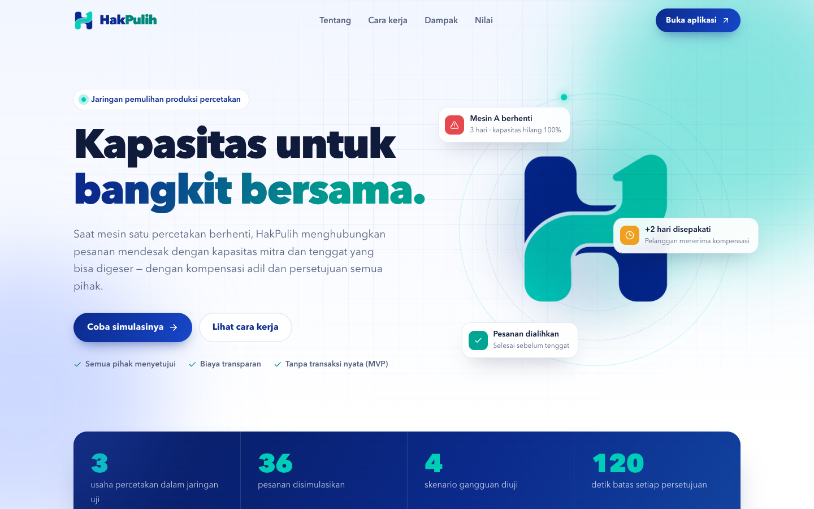
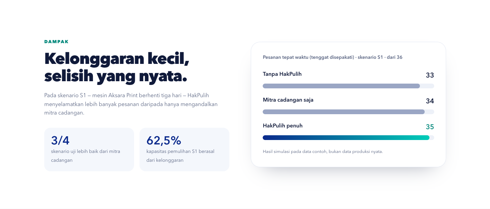
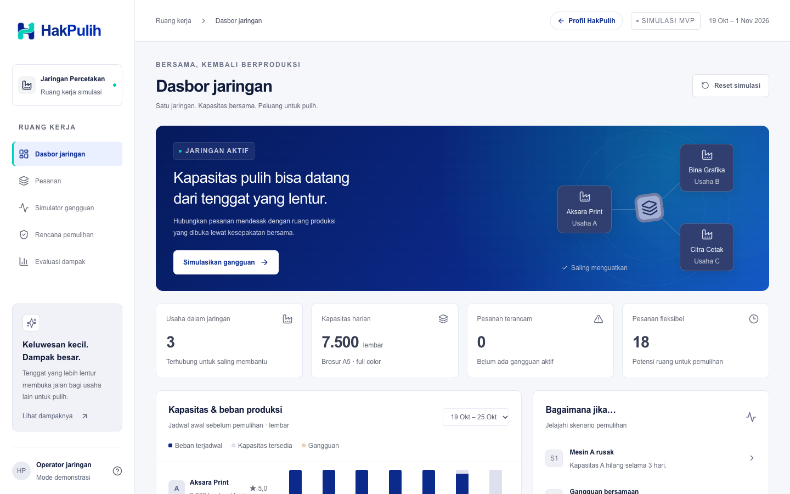
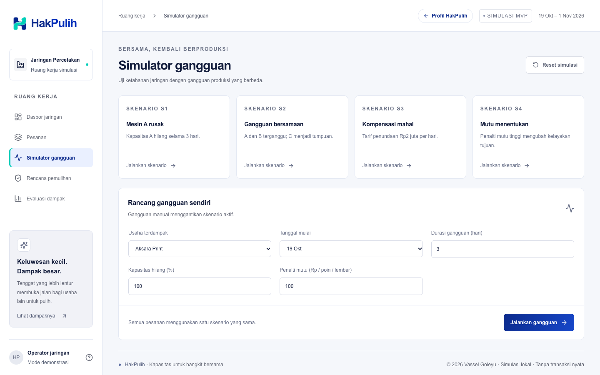
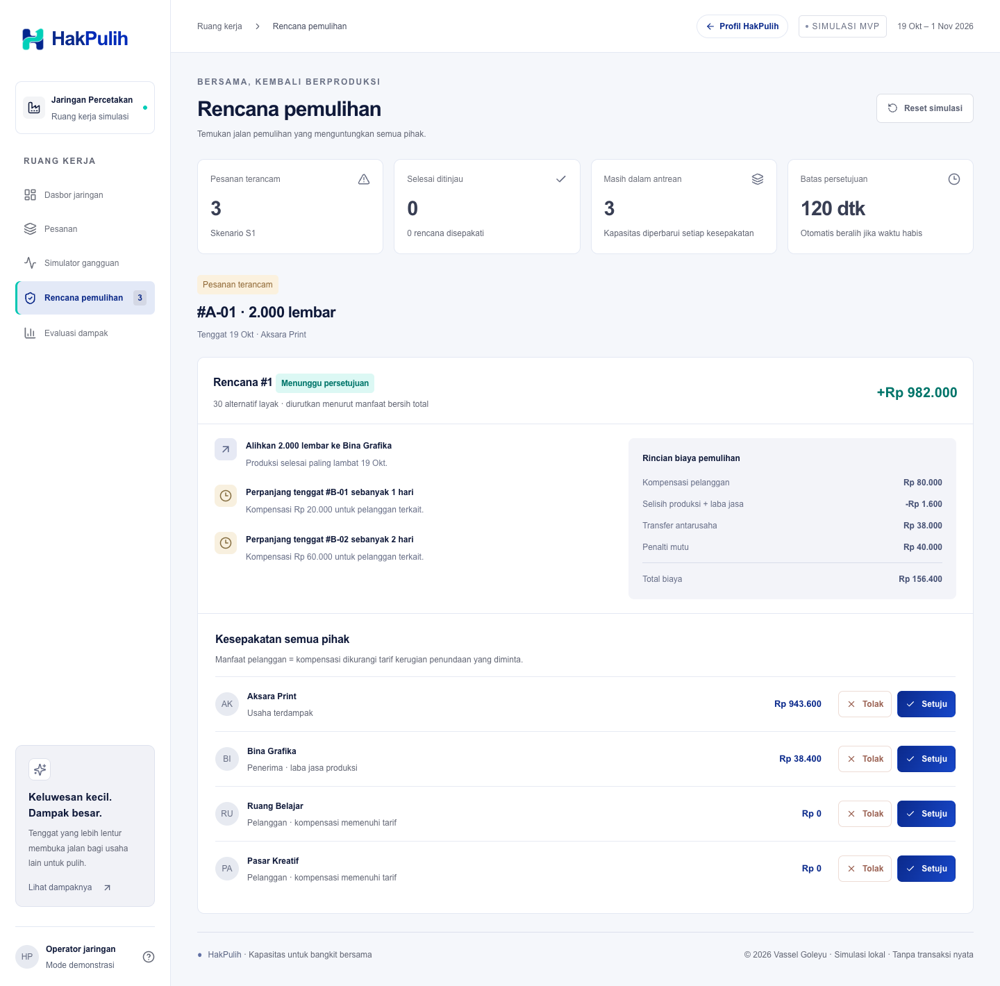
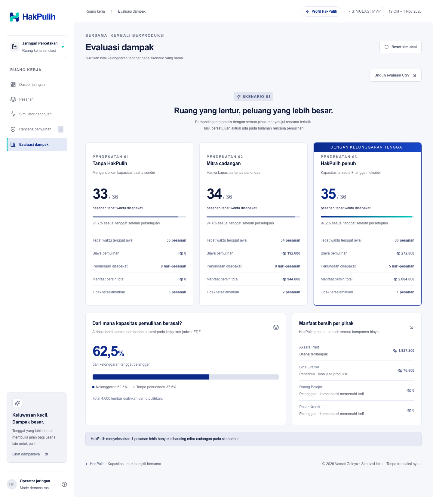
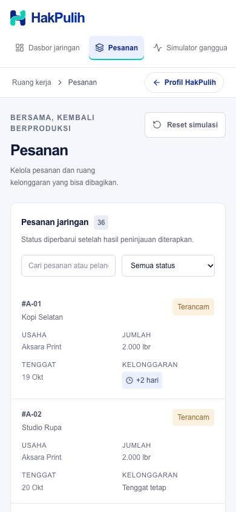
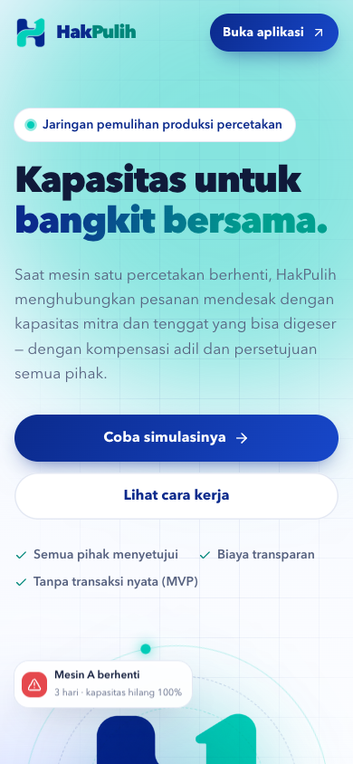

# HakPulih

MVP lokal jaringan pemulihan percetakan: kapasitas dibuka dari mesin yang masih tersedia **dan perpanjangan tenggat pesanan fleksibel**, dengan kompensasi dan persetujuan seluruh pihak terkait. Bahasa Indonesia, Rupiah, satu pekerjaan standar: brosur A5 full color.

## Tampilan

Company profile di `/`, aplikasi di `/app`.



| Dampak pada skenario S1 | Dasbor jaringan |
| --- | --- |
|  |  |

**Simulator gangguan** — pilih skenario S1–S4 atau rancang gangguan sendiri.



**Rencana pemulihan** — pengalihan, perpanjangan tenggat, rincian biaya, dan persetujuan setiap pihak.



**Evaluasi dampak** — tiga pendekatan dibandingkan pada skenario yang sama.



**Tampilan HP**

| Pesanan | Company profile |
| --- | --- |
|  |  |

## Menjalankan

Prasyarat: Node.js 22+ dan npm. Pada pemasangan pertama jalankan `npm install`. Setelah dependensi terpasang, aplikasi berjalan dengan satu perintah:

```sh
npm run dev
```

Buka http://127.0.0.1:3000 untuk company profile; aplikasi ada di http://127.0.0.1:3000/app. Server pengembangan mengikat loopback agar demo lokal tidak otomatis terbuka ke jaringan. Untuk pemeriksaan: `npm test`, `npm run typecheck`, dan `npm run build`. Mode produksi: `npm run build` lalu `npm start`.

## Struktur dan data

- `src/core/types.ts`: usaha, pelanggan, pesanan, gangguan, alokasi, rencana dan persetujuan.
- `src/core/seed.ts`: 3 usaha, 12 pelanggan, 36 pesanan, dan skenario S1–S4. Tanggal simulasi tetap 19 Oktober 2026 agar hasil dapat diulang.
- `src/core/config.ts`: seluruh parameter biaya, batas pencarian, horizon, dan durasi persetujuan.
- `src/core/solver.ts`: fungsi TypeScript murni; tanpa UI, penyimpanan, jam sistem, atau jaringan.
- `src/app/page.tsx`, `profile.css`, `profile-effects.tsx`: company profile beranimasi di `/`.
- `src/app/app/page.tsx`: aplikasi di `/app` — dasbor, formulir pesanan, simulator, peninjauan rencana, dan evaluasi.
- `src/core/session.ts`: transisi persetujuan atomik, log keputusan, dan replay sesi.
- `src/core/validation.ts`: validasi input dan data lokal; kolom tambahan dibuang.
- `src/hooks/use-network.ts`: pemuatan, pemulihan sesi browser, dan perubahan data.
- `src/server/store.ts`: antrean tulis satu proses, validasi berkas dan penggantian JSON atomik.
- `src/app/api/state/route.ts`: HTTP JSON dengan pembatasan ukuran 16 KiB, asal permintaan, dan penanganan error.
- `tests/*.test.ts`: pengujian solver, transisi sesi, dan penyimpanan.
- `tests/e2e`: alur browser desktop/mobile dan endpoint melalui Playwright.

Pesanan manual tersimpan pada `data/state.json` (dibuat saat perubahan pertama). Berkas tidak disertakan dalam Git. **Reset simulasi** hanya menghapus simulasi pada tab, bukan pesanan manual. **Reset data contoh** di halaman Pesanan mengembalikan seed setelah konfirmasi di UI. Gangguan dan log keputusan disimpan pada `sessionStorage` per tab; muat ulang memulihkan sesi dengan menghitung ulang rencana dan memainkan kembali log. Sesi hanya dipulihkan jika baseline data cocok dan log valid. Menutup tab atau menghapus storage browser dapat menghilangkan sesi. Setelah dibuka kembali, rencana yang telah kedaluwarsa beralih ke alternatif; alternatif baru mendapat 120 detik sejak ditawarkan. Penyimpanan sesi bukan catatan audit server atau kontrak persetujuan yang aman terhadap manipulasi pengguna. Layanan dirancang untuk satu operator/satu proses lokal, bukan basis data multi-server.

## Cara menggunakan

1. Periksa kapasitas harian dan pesanan pada Dasbor jaringan. Pilih pekan pertama/kedua untuk melihat seluruh horizon. Setelah hasil persetujuan diterapkan, grafik menampilkan jadwal komitmen terbaru dan tabel memperbarui status pemulihan/tenggat. Pesanan yang belum ditinjau tidak termasuk jadwal komitmen.
2. Pada Pesanan, masukkan pesanan dan tarif kompensasi minimum. Kelonggaran 0 berarti tenggat tetap. Pelanggan dan usaha dipilih dari seed.
3. Jalankan S1–S4 atau isi gangguan manual di Simulator gangguan. Setiap skenario menggantikan gangguan sebelumnya dan memakai pesanan dasar yang sama.
4. Tinjau pengalihan, perpanjangan tenggat, rincian biaya dan manfaat per pihak. Klik Setuju/Tolak untuk setiap pihak. Tidak ada pembayaran nyata.
5. Semua pihak harus setuju. Satu penolakan atau 120 detik tanpa kesepakatan mengganti rencana dengan alternatif peringkat berikutnya. Jika alternatif habis, status menjadi **tidak terselamatkan** beserta alasan. Klik **Simpan hasil & lanjutkan antrean** untuk menerapkan hasil dan menghitung rencana pesanan selanjutnya memakai kapasitas terbaru.
6. Evaluasi membandingkan tiga kebijakan pada input identik. Ini simulasi semua pihak menerima pilihan terbaik, terpisah dari riwayat keputusan aktual. Tombol **Unduh evaluasi CSV** mengekspor metrik ketiga mode; filter status dan pencarian tersedia pada tabel pesanan.

## Algoritma dan antarmuka solver

`schedule(dataset, config)` menjadwalkan setiap usaha dengan earliest deadline first (EDF), lalu ID sebagai pemutus seri. Pesanan dikerjakan dari hari 0 sampai tenggat secara preemptive: boleh dicicil antarhari, satuan lembar bulat. Kapasitas harian dikurangi gangguan; kehilangan kapasitas yang bertumpuk dijumlahkan dan dibatasi 100%. Pesanan yang tidak seluruhnya selesai sampai tenggat ditandai terancam.

`prepare(dataset, config)` mengeluarkan pesanan terancam dari jadwal komitmen. Seluruh pesanan terancam masuk antrean menurut urutan data. Pesanan yang gagal diselamatkan dianggap batal (tidak tetap mengonsumsi alokasi parsial).

`propose(datasetKomitmen, pesananTerancam, mode, config)` membangkitkan opsi pemindahan penuh atau pembagian ke dua usaha lainnya. Pembagian diuji setiap 500 lembar, ditambah opsi penuh dan sisa tepat. Pada mode penuh, backtracking mencoba penundaan 0–3 hari pada maksimal 6 pesanan fleksibel relevan, diurutkan dari tenggat paling awal lalu tarif termurah. Maksimal 6.000 kandidat diperiksa per pesanan; 30 alternatif layak terbaik disimpan. Seluruh jadwal komitmen dihitung ulang untuk setiap kandidat. Kandidat ditolak jika satu pesanan pun melanggar tenggat yang disepakati atau satu pihak memiliki manfaat negatif.

Pemilihan ini praktis untuk MVP 3 usaha/36 pesanan dan mudah diaudit. **Bukan optimasi global:** urutan antrean, batas kandidat, langkah pembagian, pemilihan enam pesanan fleksibel, dan EDF dapat melewatkan solusi lebih baik. Gangguan tidak boleh memaksa pesanan fleksibel mundur tanpa persetujuan. Mode mitra cadangan tidak mengubah tenggat; penjadwalan ulang di dalam tenggat masih diizinkan.

`evaluate(dataset, mode, config)` menjalankan antrean secara greedy dan menerapkan rencana pada salinan dataset sebelum pesanan selanjutnya. Dengan demikian dua rencana tidak mengambil slot yang sama. Semua input diperlakukan immutable. `beginApproval(plans, now, config)` dan `respond(state, partyId, decision, now, config)` memakai waktu eksplisit agar timeout dapat diuji deterministik.

Antarmuka `propose` mengembalikan `Plan[]`: transfer, penundaan, komponen biaya, pihak, jadwal pengganti, dan alokasi. Implementasi dapat diganti CP-SAT/ILP di belakang antarmuka tersebut; integrasi async/service membutuhkan adaptor pada pemanggil. CP-SAT/ILP berikutnya perlu variabel alokasi per pesanan/usaha/hari, tenggat terpilih, kapasitas, dan kendala manfaat tiap pihak; kontrak hasil UI tetap sama.

## Ekonomi dan asumsi

- Manfaat bruto usaha terdampak = margin + penalti pembatalan yang dihindari. Nilai pesanan dicatat, bukan dihitung lagi sebagai manfaat, agar pendapatan tidak dihitung ganda.
- Kompensasi = hari perpanjangan tenggat × tarif pelanggan per pesanan, bukan per lembar. Perpanjangan yang disepakati tetap dibayar walau produksi ternyata selesai lebih cepat.
- Selisih produksi = jumlah × (biaya satuan penerima − biaya satuan asal) + laba jasa penerima 8% biaya produksi penerima. Angka ini bisa negatif karena penghematan.
- Transfer = jarak × Rp2.000 + jumlah × Rp15, dibayar sekali untuk setiap tujuan transfer. Waktu transportasi diasumsikan selesai pada hari yang sama.
- Penalti mutu = jumlah × selisih skor mutu positif × bobot penalti (default Rp100/poin/lembar; S4 Rp1.000). Mutu lebih tinggi tidak diberi bonus.
- Manfaat usaha terdampak = margin + penalti batal − total biaya pemulihan.
- Manfaat penerima = laba jasa produksi; biaya produksi diganti penuh, margin pesanan asalnya tidak berubah, kompensasi pelanggan ditanggung usaha terdampak.
- Manfaat pelanggan = kompensasi diterima − tarif kerugian yang diminta. Dalam MVP kompensasi tepat setara tarif sehingga **manfaat pelanggan nol**, bukan positif ketat. Ini memenuhi syarat `>= 0`; klaim bahwa semua pihak mendapat laba positif belum terbukti. Pelanggan tetap dapat menolak.
- Manfaat total untuk pemeringkatan = jumlah manfaat pihak: usaha terdampak + laba penerima + surplus pelanggan. Karena laba penerima merupakan transfer internal, ia tidak dihitung sebagai kerugian jaringan. Detail biaya tetap memperlihatkan seluruh pengeluaran usaha terdampak.
- Kesepakatan pelanggan dikelompokkan per pelanggan jika beberapa pesanannya ditunda dalam rencana sama. Usaha penerima juga diminta menyetujui perpanjangan pesanan yang dimilikinya.
- Semua pesanan tersedia sejak hari 0. Tidak ada waktu setup, barang rusak, pengalihan sebagian pekerjaan yang sudah diproduksi, atau persediaan material. Pesanan target dialihkan seluruhnya dan hanya dihitung berhasil jika semua bagiannya selesai.
- Horizon 14 hari; input manual tenggat 0–10 dan kelonggaran 0–3 hari. Penyelesaian memakai tenggat inklusif.

## Metrik

- **Tepat waktu disepakati:** seluruh pesanan aktif dikurangi pesanan tidak terselamatkan; menggunakan tenggat yang telah diperpanjang dan diasumsikan disetujui.
- **Tepat waktu tenggat awal:** jumlah pesanan yang seluruh alokasi produksinya selesai sebelum atau pada tenggat awal, termasuk semua bagian pesanan yang dipecah. Ini dihitung dari jadwal akhir, bukan sekadar dari adanya perpanjangan tenggat.
- Biaya pemulihan: jumlah empat komponen biaya; bisa mencakup penghematan produksi.
- Keterlambatan disepakati: jumlah hari perpanjangan seluruh pesanan (hari-pesanan).
- Persentase kapasitas dari fleksibilitas: jumlah lembar yang tidak teralokasi jika transfer yang sama dijadwalkan tanpa perpanjangan tenggat, dibatasi jumlah pesanan target. Perbandingan mencakup pesanan mitra yang akan terdorong melewati tenggat, bukan hanya target. Sisanya dikategorikan kapasitas tanpa penundaan. Ini atribusi terhadap kebijakan EDF, bukan bukti kausal optimal. Jika tidak ada pemulihan, kedua sumber ditampilkan 0%.
- Manfaat bersih ditampilkan per pihak dan total. Pelanggan dengan surplus nol tetap tampil.

## Skenario dan hasil validasi

Hasil seed dari `npm run report`. Angka adalah pesanan tepat waktu sesuai tenggat yang disepakati dari total 36. Pesanan manual dapat mengubah hasil; gunakan **Reset data contoh** untuk mereproduksi.

| Skenario | Tanpa HakPulih | Mitra cadangan | HakPulih penuh | Biaya mode penuh | Hari-pesanan | Kapasitas dari kelonggaran |
| --- | ---: | ---: | ---: | ---: | ---: | ---: |
| S1 | 33 | 34 | 35 | Rp272.800 | 5 | 62,5% |
| S2 | 31 | 32 | 33 | Rp397.200 | 3 | 50% |
| S3 | 33 | 34 | 34 | Rp192.000 | 0 | 0% |
| S4 | 33 | 34 | 35 | Rp992.800 | 5 | 62,5% |

Mode penuh mengungguli mitra cadangan pada **3 skenario: S1, S2, dan S4**. Tidak ada peningkatan pada S3: kompensasi terlalu mahal. Ini memenuhi kriteria minimal dua skenario untuk tenggat yang disepakati, tetapi **tidak** menunjukkan peningkatan ketepatan terhadap janji awal: mode penuh menyelesaikan 33, 31, 34, dan 33 pesanan sesuai tenggat awal pada S1–S4. Ada pertukaran manfaat antara pelanggan fleksibel dan pesanan mendesak.

Manfaat total mode penuh berturut-turut Rp2.004.000, Rp1.876.000, Rp944.000, dan Rp1.284.000. S4 menaikkan biaya mutu; pada mode mitra cadangan, pengalihan A-02 yang dipilih S1 tidak lagi layak, sehingga A-03 dipilih dengan proporsi lebih banyak ke B. Pada mode penuh S4, tujuan B tetap dipilih, tetapi manfaat turun Rp720.000 dibanding S1.

- **S1:** mesin A rusak 3 hari, kapasitas hilang 100%. Ekspektasi: pelanggan B/C yang bersedia menunda membuka kapasitas, sehingga mode penuh menyelamatkan lebih banyak daripada mitra cadangan.
- **S2:** A hilang 100% selama 3 hari dan B hilang 80% selama 2 hari. Ekspektasi: lebih banyak pesanan terancam dan ruang pemulihan lebih sempit; tidak ada penggunaan kapasitas B yang hilang.
- **S3:** gangguan S1 dengan kompensasi Rp2 juta/hari. Ekspektasi: kandidat perpanjangan tidak layak karena melebihi manfaat; kelonggaran bukan sumber kapasitas gratis.
- **S4:** gangguan S1, bobot penalti mutu Rp1.000. Ekspektasi: tujuan bermutu lebih rendah menjadi mahal, mengubah tujuan/rencana layak dan menurunkan manfaat dibanding bobot default.

## Risiko & Validasi

1. **Mutu produksi tidak diabaikan.** Skor asal/tujuan menjadi biaya eksplisit. Uji menaikkan bobot mutu dan memeriksa manfaat tidak meningkat. Namun skor 1–5 belum divalidasi terhadap biaya cetak ulang nyata.
2. **Gangguan bersamaan mengurangi kapasitas pemulihan.** S2 diuji dengan jadwal kapasitas harian. Asumsi independensi listrik, pemasok, dan lokasi perlu data lapangan.
3. **Kompensasi dapat melebihi nilai pemulihan.** S3 memeriksa rencana yang menunda tidak diterima bila merugikan usaha terdampak.
4. **Semua pihak wajib nonnegatif.** Uji eksplisit menolak satu pihak negatif; biaya penerima diganti penuh, laba jasa dibayarkan, tarif pelanggan dipenuhi. Surplus pelanggan masih nol; validasi lapangan perlu menguji apakah tarif tersebut benar-benar cukup dan apakah persetujuan diberikan.
5. **Kapasitas tidak dihitung ganda.** Uji menelusuri setiap usaha/hari setelah seluruh rencana diterapkan dan memeriksa jumlah transfer lengkap.
6. **Penolakan bukan kegagalan sistem.** Uji persetujuan lengkap, fallback saat penolakan, timeout, dan habisnya alternatif. Tidak ada rencana layak dalam pencarian terbatas tidak membuktikan tak ada solusi global.
7. **Evaluasi bukan hasil operasional nyata.** Pengalihan, transportasi, kompensasi dan persetujuan disimulasikan. Tidak ada pembayaran, autentikasi kompleks, pelacakan kurir, atau kontrak legal.
8. **Keterbatasan operasional.** Persetujuan dipulihkan per tab, tetapi belum ada persistence audit server, autentikasi, penguncian lintas proses, atau dukungan deployment publik. Server lokal sebaiknya digunakan untuk demo pada lingkungan tepercaya.

## Pemeriksaan yang telah dijalankan

- `npm test`: **46 test lulus** (termasuk minimal dua skenario unggul, immutable input, batas kelonggaran kumulatif, pembulatan kapasitas, dan fallback persetujuan).
- `npm run typecheck`: lulus; build produksi juga memeriksa tipe.
- `npm run build`: lulus pada Next.js 15.5.28.
- Smoke test server produksi melalui HTTP: halaman utama 200, seed 36 pesanan, input jumlah negatif ditolak (400), pesanan valid tersimpan dan terbaca ulang, reset berhasil.
- **7 test browser produksi lulus** pada Chrome desktop/mobile, termasuk persetujuan, timeout, reload, penambahan pesanan, reset, S1–S4, CSV, gagal muat/retry, dan batas API. Test ada pada `tests/e2e`; jalankan `npm run build` lalu `npm run test:e2e`. Konfigurasi menggunakan Chrome lokal pada macOS bila tersedia, atau Chromium Playwright (`npx playwright install chromium`). `PLAYWRIGHT_CHROMIUM_EXECUTABLE` dapat menunjuk executable browser lain. Data uji disimpan terpisah di `/private/tmp/hakpulih-e2e-data`; tes tidak mengubah `data/state.json`.
- `npm audit`: 0 temuan setelah pembaruan Vitest dan override PostCSS 8.5.30+. Temuan database kerentanan dapat berubah di kemudian hari.

Instalasi/build sempat terhalang ruang disk penuh. Cache unduhan tugas dibersihkan dan build berhasil. Cache webpack produksi dinonaktifkan di `next.config.ts` untuk mengurangi penggunaan disk; dependensi dan hasil build tetap membutuhkan ruang kosong yang cukup.

## Perubahan audit

Lihat [AUDIT.md](AUDIT.md) untuk daftar bug yang diperbaiki, metode verifikasi, dan batasan tersisa. Format kode telah dirapikan (`npm run format`) dan logika penyimpanan/sesi dipisah dari UI agar perubahan berikutnya lebih mudah diuji.

Variabel lingkungan opsional `HAKPULIH_DATA_DIR` menentukan direktori penyimpanan JSON; default `data/`. Gunakan direktori terpisah saat menjalankan pengujian API. Error penyimpanan mengembalikan HTTP 500 tanpa membocorkan detail jalur, sedangkan kesalahan input mengembalikan 400. Berkas rusak tidak ditimpa saat penambahan; pulihkan dari cadangan atau gunakan reset eksplisit.

---

© 2026 Vassel Goleyu. All rights reserved. Kode dan aset (termasuk nama dan logo HakPulih) tidak boleh digunakan, disalin, atau didistribusikan tanpa izin tertulis; lihat [LICENSE](LICENSE).
